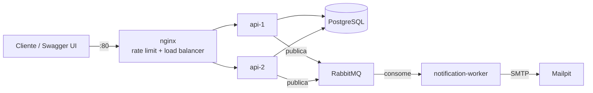

# distr-arch-todo-list

API RESTful de lista de tarefas com autenticação, controle de acesso por papéis (ADMIN/USER), API Gateway com rate limit e load balancer, e mensageria com RabbitMQ para envio de emails.

> Projeto em desenvolvimento. As seções marcadas como *planejado* ainda não foram implementadas.

## Opções escolhidas

- **(a) API Gateway com Rate Limit e Load Balancer** — nginx na frente de duas instâncias da API *(planejado)*
- **(b) Mensageria com RabbitMQ** — producer na API, consumer no notification-worker, filas `email.password-reset` e `email.welcome` *(planejado)*

## Stack

- Java 21, Spring Boot 4.1
- PostgreSQL 17 + Flyway
- Spring Security + JWT
- RabbitMQ
- nginx
- springdoc-openapi (Swagger UI)
- Docker Compose

## Arquitetura (alvo)



- Somente a `api` possui banco de dados. As instâncias `api-1` e `api-2` compartilham o mesmo banco, pois são réplicas do mesmo serviço.
- O `notification-worker` é stateless: consome mensagens e envia emails.

## Estrutura do repositório

```
.
├── docker-compose.yml
├── .env.example
├── pom.xml                         # Maven parent (multi-módulo)
├── infra/
│   └── postgres/Dockerfile
├── libs/
│   └── messaging-contracts/        # eventos e nomes de filas compartilhados
└── services/
    ├── api/                        # API REST, auth, RBAC, todos, producer
    └── notification-worker/        # consumer RabbitMQ, envio de emails
```

## Pré-requisitos

- Docker e Docker Compose
- Java 21 (apenas para rodar/compilar fora do Docker)

## Como executar

```bash
docker compose up -d --build
```

Não é necessário criar `.env`: o compose usa valores padrão. Para customizar, copie `.env.example` para `.env`.

Para parar e remover os volumes (apaga os dados do banco):

```bash
docker compose down -v
```

### Build e testes locais

```bash
./mvnw clean package -DskipTests
./mvnw verify   # requer Docker em execução (Testcontainers)
```

## Portas

| Serviço    | Porta | Descrição               |
|------------|-------|-------------------------|
| PostgreSQL | 5432  | Banco de dados da `api` |

## Variáveis de ambiente

| Variável            | Padrão     | Descrição                    |
|---------------------|------------|------------------------------|
| `POSTGRES_DB`       | `todolist` | Nome do banco                |
| `POSTGRES_USER`     | `todolist` | Usuário do banco             |
| `POSTGRES_PASSWORD` | `todolist` | Senha do banco               |
| `POSTGRES_PORT`     | `5433`     | Porta exposta no host        |
