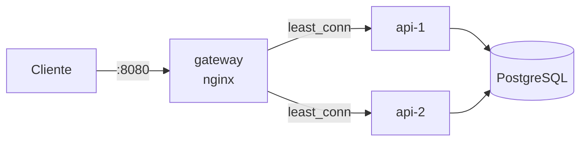
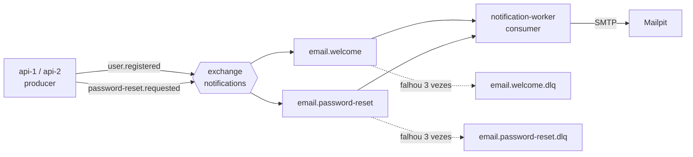

# distr-arch-todo-list

API REST de lista de tarefas com cadastro, login via **JWT** e controle de acesso por papéis (**ADMIN** / **USER**), servida por **duas réplicas** atrás de um **API Gateway nginx** com rate limit e load balancer, e com **emails assíncronos via RabbitMQ** (boas-vindas e código de redefinição de senha). Construída como trabalho da disciplina de Arquitetura Distribuída.

A aplicação inteira sobe com um único comando (`docker compose up`), sem nenhum passo manual.

## Sumário

- [Status do projeto](#status-do-projeto)
- [Opções escolhidas do trabalho](#opções-escolhidas-do-trabalho)
- [Stack](#stack)
- [Início rápido](#início-rápido)
- [Primeiros passos com a API](#primeiros-passos-com-a-api)
- [Endpoints](#endpoints)
- [Gateway: load balancer e rate limit](#gateway-load-balancer-e-rate-limit)
- [Mensageria: emails com RabbitMQ](#mensageria-emails-com-rabbitmq)
- [Configuração](#configuração)
- [Rodando a API fora do Docker](#rodando-a-api-fora-do-docker)
- [Testes](#testes)
- [Estrutura do repositório](#estrutura-do-repositório)
- [Solução de problemas](#solução-de-problemas)
- [Documentação detalhada](#documentação-detalhada)

## Opções escolhidas do trabalho

O enunciado pede exatamente 2 de 3 opções. Foram escolhidas:

- **(a) API Gateway com Rate Limit e Load Balancer**: nginx como porta de entrada única, distribuindo as requisições entre `api-1` e `api-2` e limitando requisições por IP. Ver [Gateway](#gateway-load-balancer-e-rate-limit).
- **(b) Mensageria com RabbitMQ**: a API (producer) publica eventos e o `notification-worker` (consumer) envia os emails. Duas filas com propósitos diferentes, `email.welcome` e `email.password-reset`, cada uma com retry e fila de mensagens mortas. Ver [Mensageria](#mensageria-emails-com-rabbitmq).

## Stack

| Camada           | Tecnologia                                   |
|------------------|----------------------------------------------|
| Linguagem        | Java 21                                      |
| Framework        | Spring Boot 4.1 (Web MVC, Data JPA, Security, AMQP, Mail) |
| Banco de dados   | PostgreSQL 17                                |
| Migrations       | Flyway                                       |
| Autenticação     | JWT (HS256) com Spring Security OAuth2 Resource Server |
| API Gateway      | nginx 1.30                                   |
| Mensageria       | RabbitMQ 4.2                                 |
| Emails           | Thymeleaf (templates) + Mailpit (SMTP de desenvolvimento) |
| Documentação     | springdoc-openapi (Swagger UI)               |
| Testes           | JUnit 5, MockMvc, Awaitility, Testcontainers |
| Infraestrutura   | Docker, Docker Compose                       |

## Início rápido

### 1. Pré-requisitos

- [Docker Desktop](https://www.docker.com/products/docker-desktop/) (ou Docker Engine + Compose) **em execução**
- Git

Java 21 só é necessário para compilar ou rodar os testes fora do Docker.

### 2. Clonar e subir

```bash
git clone git@github.com:arthuurdp/distr-arch-todo-list.git
cd distr-arch-todo-list
docker compose up -d --build
```

O primeiro build baixa as dependências Maven e as imagens base, então pode levar alguns minutos. Os próximos são bem mais rápidos.

### 3. Conferir se subiu

```bash
docker compose ps
```

Os sete serviços devem aparecer como `healthy`:

```
SERVICE               STATUS          PORTS
api-1                 Up (healthy)    8080/tcp
api-2                 Up (healthy)    8080/tcp
gateway               Up (healthy)    0.0.0.0:8080->80/tcp
mailpit               Up (healthy)    1025/tcp, 0.0.0.0:8025->8025/tcp
notification-worker   Up (healthy)    8080/tcp
postgres              Up (healthy)    0.0.0.0:5432->5432/tcp
rabbitmq              Up (healthy)    0.0.0.0:5672->5672/tcp, 0.0.0.0:15672->15672/tcp
```

### 4. Acessar

| O quê                  | URL                                         | Credenciais |
|------------------------|---------------------------------------------|-------------|
| Swagger UI             | http://localhost:8080/swagger-ui.html       | — |
| Base da API            | http://localhost:8080/api                   | — |
| Health da API          | http://localhost:8080/actuator/health       | — |
| Health do gateway      | http://localhost:8080/gateway/health        | — |
| Caixa de entrada (Mailpit) | http://localhost:8025                   | — |
| Painel do RabbitMQ     | http://localhost:15672                      | `todolist` / `todolist` |

### Parar

```bash
docker compose down        # para os containers e mantém os dados
docker compose down -v     # para e APAGA os dados do banco e do RabbitMQ
```

## Primeiros passos com a API

Quase todas as rotas exigem um token. O fluxo é sempre:

1. Fazer login e receber o `accessToken`.
2. Enviar o token no header `Authorization: Bearer <accessToken>` em cada requisição.

### Usuário administrador de desenvolvimento

Criado automaticamente pela migration `V3__seed_admin_user.sql`:

| Email                | Senha         | Papel |
|----------------------|---------------|-------|
| `admin@todolist.com` | `Admin@12345` | ADMIN |

Para testar como `USER`, cadastre uma conta nova em `POST /api/auth/register`; o email de boas-vindas aparece no [Mailpit](http://localhost:8025).

### Pelo Swagger UI

1. Abra http://localhost:8080/swagger-ui.html.
2. Em **auth-controller**, execute `POST /api/auth/login` com:
   ```json
   { "email": "admin@todolist.com", "password": "Admin@12345" }
   ```
3. Copie o valor de `accessToken` da resposta.
4. Clique em **Authorize** (cadeado no topo), cole **só o token**, sem a palavra `Bearer`, e confirme.
5. A partir daí, as requisições do Swagger já vão autenticadas. Teste `GET /api/todos`.

### Pelo terminal (Bash / Git Bash)

```bash
# 1. Login: guarda o token numa variável
TOKEN=$(curl -s -X POST http://localhost:8080/api/auth/login \
  -H "Content-Type: application/json" \
  -d '{"email": "admin@todolist.com", "password": "Admin@12345"}' \
  | sed -E 's/.*"accessToken":"([^"]+)".*/\1/')

# 2. Criar uma tarefa
curl -X POST http://localhost:8080/api/todos \
  -H "Authorization: Bearer $TOKEN" \
  -H "Content-Type: application/json" \
  -d '{"title": "Test todo", "description": "Test description", "dueDate": "2026-09-30"}'

# 3. Listar as tarefas
curl http://localhost:8080/api/todos -H "Authorization: Bearer $TOKEN"
```

### Pelo PowerShell

No Windows PowerShell, `curl` é um apelido para `Invoke-WebRequest` e não aceita os parâmetros acima. Use `Invoke-RestMethod`:

```powershell
# 1. Login
$login = Invoke-RestMethod -Method Post -Uri http://localhost:8080/api/auth/login `
  -ContentType "application/json" `
  -Body '{"email": "admin@todolist.com", "password": "Admin@12345"}'
$headers = @{ Authorization = "Bearer $($login.accessToken)" }

# 2. Criar uma tarefa
Invoke-RestMethod -Method Post -Uri http://localhost:8080/api/todos -Headers $headers `
  -ContentType "application/json" `
  -Body '{"title": "Test todo", "description": "Test description", "dueDate": "2026-09-30"}'

# 3. Listar as tarefas
Invoke-RestMethod -Uri http://localhost:8080/api/todos -Headers $headers
```

### Pelo VS Code

O arquivo [http/api.http](http/api.http) tem todas as requisições prontas, com o token sendo reaproveitado automaticamente. Instale a extensão [REST Client](https://marketplace.visualstudio.com/items?itemName=humao.rest-client) e clique em **Send Request** acima de cada requisição.

## Endpoints

Referência completa, com corpo das requisições, validações, exemplos de resposta e erros: [docs/API.md](docs/API.md).

| Método | Rota                           | Acesso      | Descrição                                              |
|--------|--------------------------------|-------------|--------------------------------------------------------|
| POST   | `/api/auth/register`           | Público     | Cria uma conta (sempre `USER`) e envia email de boas-vindas |
| POST   | `/api/auth/login`              | Público     | Autentica e retorna o JWT                              |
| POST   | `/api/auth/forgot-password`    | Público     | Envia por email um código de 6 dígitos para redefinir a senha |
| POST   | `/api/auth/reset-password`     | Público     | Define uma nova senha usando o código recebido         |
| GET    | `/api/auth/me`                 | Autenticado | Dados do usuário dono do token                         |
| GET    | `/api/todos`                   | Autenticado | Lista paginada (filtro `completed`, `page`, `size`, `sort`) |
| GET    | `/api/todos/{id}`              | Autenticado | Busca uma tarefa                                       |
| POST   | `/api/todos`                   | Autenticado | Cria uma tarefa                                        |
| PUT    | `/api/todos/{id}`              | Autenticado | Substitui os dados de uma tarefa                       |
| DELETE | `/api/todos/{id}`              | Autenticado | Remove uma tarefa                                      |
| GET    | `/api/admin/users`             | ADMIN       | Lista usuários                                         |
| PATCH  | `/api/admin/users/{id}/role`   | ADMIN       | Altera o papel de um usuário                           |
| DELETE | `/api/admin/users/{id}`        | ADMIN       | Remove um usuário e todas as tarefas dele              |

**Quem vê o quê:**

- `USER` só enxerga e altera **as próprias** tarefas. A tarefa de outra pessoa responde `404`, como se não existisse.
- `ADMIN` enxerga e altera as tarefas de **todos** e gerencia usuários.

Como o JWT e a redefinição de senha funcionam nesta API: [docs/AUTENTICACAO.md](docs/AUTENTICACAO.md).

## Gateway: load balancer e rate limit



**Load balancer**

- As requisições são distribuídas entre `api-1` e `api-2` pelo algoritmo `least_conn` (vai para a réplica com menos conexões ativas).
- Se uma réplica cai, o gateway para de enviar requisições para ela e usa a outra (*failover*), sem o cliente perceber.
- Toda resposta da API traz o header **`X-Instance-Id`** dizendo qual réplica atendeu.
- Qualquer réplica aceita o token emitido por qualquer outra, porque o JWT é stateless e todas usam o mesmo `JWT_SECRET`.

**Rate limit** (por IP, antes de a requisição chegar à API)

| Rotas | Limite | Rajada tolerada |
|-------|--------|-----------------|
| `POST /api/auth/login`, `register`, `forgot-password`, `reset-password` | 10 por minuto | 5 extras |
| Todas as demais | 10 por segundo | 20 extras |

Ao exceder o limite, o gateway responde `429 Too Many Requests`.

Detalhes e justificativas das escolhas: [docs/ARQUITETURA.md](docs/ARQUITETURA.md#5-api-gateway-com-nginx).

### Demonstrações do gateway

**Balanceamento:** envia 10 requisições e mostra qual réplica atendeu cada uma.

```bash
bash scripts/lb-demo.sh
```
```powershell
.\scripts\lb-demo.ps1
```

**Rate limit:** faz 15 tentativas de login seguidas; as primeiras chegam à API (`401`, senha errada) e o restante é bloqueado pelo gateway (`429`).

```bash
bash scripts/rate-limit-demo.sh
```
```powershell
.\scripts\rate-limit-demo.ps1
```

> Se o PowerShell bloquear a execução de scripts, rode antes, só para a sessão atual: `Set-ExecutionPolicy -Scope Process Bypass`.

**Failover:** derruba uma réplica e mostra que a API continua respondendo pela outra.

```bash
docker compose stop api-1
bash scripts/lb-demo.sh          # todas as respostas vêm da api-2
docker compose start api-1       # aguarde ficar healthy (docker compose ps)
bash scripts/lb-demo.sh          # volta a alternar
```

**Logs do gateway:** cada linha mostra a réplica que atendeu (`upstream=`) e se o rate limit agiu (`rate_limit=`).

```bash
docker compose logs -f gateway
```

## Mensageria: emails com RabbitMQ



| Fila | Evento | Propósito |
|------|--------|-----------|
| `email.welcome` | `UserRegisteredEvent` | Email de boas-vindas após o cadastro |
| `email.password-reset` | `PasswordResetRequestedEvent` | Email com o código de 6 dígitos para redefinir a senha |
| `email.welcome.dlq`, `email.password-reset.dlq` | — | Mensagens que falharam 3 vezes seguidas (fila de mensagens mortas) |

- A API publica o evento **só depois do commit** no banco e responde na hora, sem esperar o email ser enviado.
- O worker tenta processar cada mensagem até **3 vezes** (esperando 1s e depois 2s). Se ainda falhar, a mensagem vai para a `.dlq`, em vez de ficar travando a fila.
- Se o worker estiver parado, as mensagens **ficam guardadas** na fila e são processadas quando ele voltar.

Detalhes e justificativas: [docs/ARQUITETURA.md](docs/ARQUITETURA.md#6-mensageria-com-rabbitmq).

### Demonstrações da mensageria

**Email de boas-vindas (producer e consumer)**

1. Cadastre um usuário em `POST /api/auth/register` (Swagger ou [http/api.http](http/api.http)).
2. Abra o [Mailpit](http://localhost:8025): o email "Welcome to Todo List" chega em instantes.

**Redefinição de senha com código de 6 dígitos**

1. `POST /api/auth/forgot-password` com `{"email": "test@gmail.com"}`: responde `202`.
2. No [Mailpit](http://localhost:8025), abra o email "Your password reset code" e copie o código.
3. `POST /api/auth/reset-password` com `{"email": "test@gmail.com", "code": "<código>", "newPassword": "NewPassword123!"}`: responde `204`.
4. Faça login com a nova senha.

**Filas no painel do RabbitMQ**

Em http://localhost:15672 (`todolist` / `todolist`), aba **Queues and Streams**: as quatro filas, a quantidade de mensagens em cada uma e a taxa de publicação e consumo. Aba **Exchanges** → `notifications`: as ligações (*bindings*) de cada routing key.

**Worker parado: mensagens esperam na fila**

```bash
docker compose stop notification-worker
```
Cadastre um usuário: a fila `email.welcome` fica com 1 mensagem **Ready** no painel e nenhum email chega. Então:
```bash
docker compose start notification-worker
```
A mensagem é consumida e o email aparece no Mailpit.

**Falha no envio: retry e fila de mensagens mortas (DLQ)**

O script faz todos os passos de uma vez: para o Mailpit, cadastra um usuário, aguarda a mensagem cair na DLQ e religa o Mailpit.

```bash
bash scripts/dlq-demo.sh
```
```powershell
.\scripts\dlq-demo.ps1
```

Passo a passo, manualmente:

```bash
docker compose stop mailpit
```
Cadastre um usuário. Nos logs do worker aparecem as tentativas falhando (cada uma espera até 5s pelo servidor SMTP), e em até 20 segundos a mensagem aparece em `email.welcome.dlq`:
```bash
docker compose logs -f notification-worker
```
Para reprocessar: suba o Mailpit de novo (`docker compose start mailpit`), abra a fila `email.welcome.dlq` no painel do RabbitMQ e use **Move messages** com destino `email.welcome`. O email é enviado.

## Configuração

### Variáveis de ambiente

O `docker-compose.yml` já tem valores padrão para tudo, então **não é preciso criar `.env`**. Para customizar, copie o exemplo e edite:

```bash
cp .env.example .env
```

| Variável                   | Padrão no compose                          | Descrição                                                |
|----------------------------|--------------------------------------------|----------------------------------------------------------|
| `POSTGRES_DB`              | `todolist`                                 | Nome do banco                                            |
| `POSTGRES_USER`            | `todolist`                                 | Usuário do banco                                         |
| `POSTGRES_PASSWORD`        | `todolist`                                 | Senha do banco                                           |
| `POSTGRES_PORT`            | `5432`                                     | Porta do Postgres exposta no host                        |
| `GATEWAY_PORT`             | `8080`                                     | Porta do gateway exposta no host (entrada da aplicação)  |
| `JWT_SECRET`               | `dev-only-jwt-secret-change-me-0123456789` | Chave que assina os tokens (mínimo 32 caracteres)        |
| `RABBITMQ_USER`            | `todolist`                                 | Usuário do RabbitMQ (API, worker e painel)               |
| `RABBITMQ_PASSWORD`        | `todolist`                                 | Senha do RabbitMQ                                        |
| `RABBITMQ_PORT`            | `5672`                                     | Porta AMQP exposta no host                               |
| `RABBITMQ_MANAGEMENT_PORT` | `15672`                                    | Porta do painel do RabbitMQ                              |
| `MAILPIT_UI_PORT`          | `8025`                                     | Porta da caixa de entrada do Mailpit                     |

> As credenciais do banco e do RabbitMQ só são aplicadas quando os volumes são criados pela primeira vez. Se mudá-las depois, é preciso recriar os volumes com `docker compose down -v`, o que apaga os dados.

### Gerando um `JWT_SECRET` seguro

O valor padrão serve apenas para desenvolvimento. Para gerar um aleatório:

```bash
openssl rand -base64 32
```

```powershell
$bytes = New-Object byte[] 32
[System.Security.Cryptography.RandomNumberGenerator]::Create().GetBytes($bytes)
[Convert]::ToBase64String($bytes)
```

As duas réplicas recebem automaticamente o mesmo valor pelo compose. Se fossem diferentes, um token emitido pela `api-1` seria recusado pela `api-2`.

### Portas

| Serviço               | Porta no host | Observação                                              |
|-----------------------|---------------|---------------------------------------------------------|
| gateway               | 8080          | Única entrada da API                                    |
| api-1, api-2          | nenhuma       | Acessíveis apenas pelo gateway, na rede interna do Docker |
| notification-worker   | nenhuma       | Só consome filas; não recebe requisições HTTP de clientes |
| postgres              | 5432          | Útil para inspecionar o banco (pgAdmin, DBeaver, psql)  |
| rabbitmq              | 5672, 15672   | AMQP e painel de administração                          |
| mailpit               | 8025          | Caixa de entrada web (o SMTP, porta 1025, é interno)    |

Para conectar um cliente de banco: host `127.0.0.1`, porta `5432`, banco/usuário/senha `todolist`.

## Rodando a API fora do Docker

Útil para depurar pela IDE. Como o gateway ocupa a porta 8080, rode a API local em outra porta:

```bash
docker compose up -d postgres rabbitmq mailpit
```

Depois rode a classe `com.todolist.api.ApiApplication` pela IDE com as variáveis de ambiente:

```
SERVER_PORT=8081
SPRING_RABBITMQ_USERNAME=todolist
SPRING_RABBITMQ_PASSWORD=todolist
```

O `application.yaml` já aponta para o Postgres e o RabbitMQ em `localhost`. Essa instância é acessada diretamente em `http://localhost:8081`, sem passar pelo gateway. O `notification-worker` pode ser rodado da mesma forma (`com.todolist.worker.NotificationWorkerApplication`, com `SERVER_PORT=8082` e as mesmas credenciais do RabbitMQ).

## Testes

```bash
./mvnw verify
```

Requer o Docker em execução. Os testes usam **Testcontainers**, que sobe PostgreSQL e RabbitMQ descartáveis, então nada é gravado nos serviços do compose.

| Módulo | Classe                       | O que cobre                                                                  |
|--------|------------------------------|------------------------------------------------------------------------------|
| api    | `AuthControllerTests`        | Cadastro sempre como USER, email duplicado, validação, login, token em `/me`, mesma resposta para senha errada e email inexistente, login do admin semeado |
| api    | `AuthNotificationTests`      | Evento publicado no cadastro, fluxo completo de redefinição de senha lendo o código da fila, email inexistente sem evento, limite de tentativas, uso único, código expirado |
| api    | `TodoControllerTests`        | CRUD, filtro e paginação, 401 sem token ou com token inválido, isolamento entre usuários, visão do ADMIN, `sort` fora da lista permitida |
| api    | `AdminUserControllerTests`   | 403 para USER, listagem, troca de papel, remoção em cascata, admin não altera nem remove a si mesmo |
| api    | `GatewayHeadersTests`        | Header `X-Instance-Id` em todas as respostas (inclusive erros) e header `Location` usando o endereço do gateway |
| worker | `NotificationListenerTests`  | Eventos publicados viram emails, código incluído no email, código expirado não é enviado, mensagem com falha vai para a DLQ após os retries |

Para rodar só um módulo ou uma classe:

```bash
./mvnw -pl services/notification-worker -am verify
./mvnw -pl services/api verify -Dtest=TodoControllerTests
```

O comportamento do gateway (balanceamento, rate limit e failover) é verificado com os [scripts de demonstração](#demonstrações-do-gateway) contra a aplicação rodando.

## Estrutura do repositório

```
.
├── docker-compose.yml              # sobe toda a aplicação
├── .env.example                    # exemplo de variáveis de ambiente
├── pom.xml                         # Maven parent (multi-módulo)
├── docs/
│   ├── API.md                      # referência dos endpoints
│   ├── AUTENTICACAO.md             # JWT, papéis, redefinição de senha e segurança
│   └── ARQUITETURA.md              # decisões de arquitetura
├── http/
│   └── api.http                    # requisições prontas (VS Code REST Client)
├── infra/
│   ├── mailpit/Dockerfile          # SMTP de desenvolvimento com caixa de entrada web
│   ├── nginx/                      # API Gateway: Dockerfile + nginx.conf
│   ├── postgres/Dockerfile
│   └── rabbitmq/                   # broker: Dockerfile + rabbitmq.conf
├── scripts/                        # demonstrações de load balancer e rate limit (Bash e PowerShell)
├── libs/
│   └── messaging-contracts/        # eventos, nomes de filas e topologia do RabbitMQ (compartilhados)
└── services/
    ├── api/
    │   ├── Dockerfile
    │   └── src/main/java/com/todolist/api/
    │       ├── auth/               # cadastro, login, token, redefinição de senha
    │       ├── notification/       # producer: publica eventos no RabbitMQ após o commit
    │       ├── todo/               # tarefas
    │       ├── user/               # usuários e endpoints de admin
    │       └── shared/             # segurança, configs, erros, paginação
    └── notification-worker/
        ├── Dockerfile
        └── src/main/
            ├── java/com/todolist/worker/
            │   ├── listener/       # consumer: um @RabbitListener por fila
            │   └── email/          # montagem e envio dos emails
            └── resources/templates/email/   # templates HTML (Thymeleaf)
```

## Solução de problemas

| Sintoma | Causa e solução |
|---------|-----------------|
| `failed to connect to the docker API` | O Docker Desktop não está aberto. Abra-o e aguarde ficar pronto. |
| `port is already allocated` | Outro processo ou container já usa a porta. Troque no `.env` (`POSTGRES_PORT`, `GATEWAY_PORT`, `RABBITMQ_PORT`, `RABBITMQ_MANAGEMENT_PORT` ou `MAILPIT_UI_PORT`). |
| `port is already allocated` na 8080 logo após atualizar o projeto | Um container antigo `api` (de antes do gateway) ainda está rodando. Suba com `docker compose up -d --build --remove-orphans`. |
| Algum serviço fica `unhealthy` | Veja o motivo com `docker compose logs <serviço>`. As APIs esperam o Postgres e o RabbitMQ; o gateway espera as duas APIs; o worker espera o RabbitMQ e o Mailpit. |
| `Migration checksum mismatch` nos logs | Uma migration já aplicada foi alterada (inclusive só um comentário). Migrations são imutáveis; em ambiente de desenvolvimento, recrie o banco com `docker compose down -v` (apaga os dados). |
| Email não chegou no Mailpit | Veja `docker compose logs notification-worker` e o painel do RabbitMQ: a mensagem pode estar parada na fila (worker fora) ou na `.dlq` (falha no envio). O código de redefinição também não é enviado para emails não cadastrados. |
| `400 Invalid password reset code` | Código errado, expirado (15 min), já usado, substituído por um pedido mais novo ou bloqueado após 5 tentativas. Peça um novo em `forgot-password`. |
| `429 Too Many Requests` | O rate limit do gateway agiu. Em login, cadastro e redefinição de senha, o limite é de 10 por minuto: aguarde alguns segundos. |
| `502 Bad Gateway` vindo do gateway | Nenhuma réplica da API está de pé. Confira com `docker compose ps`. |
| `401 Unauthorized` com token | O token expirou (validade de 1h), foi copiado incompleto, ou foi colado com `Bearer` duplicado no Swagger. Faça login de novo. |
| `403 Forbidden` depois de virar ADMIN | O papel fica gravado dentro do token. Faça login de novo para receber um token com o papel atualizado. |
| Testes falham com `NoClassDefFoundError` depois de editar código na IDE | O compilador da IDE pode gravar classes em `target/` durante a edição. Rode `./mvnw clean verify`. |
| pgAdmin recusa a senha correta | Use `127.0.0.1` em vez de `localhost` como host. |
| `curl` falha no PowerShell | Use `curl.exe` ou os exemplos com `Invoke-RestMethod` acima. |

## Documentação detalhada

- [docs/API.md](docs/API.md): referência de todos os endpoints, com exemplos reais de requisição e resposta.
- [docs/AUTENTICACAO.md](docs/AUTENTICACAO.md): como o JWT é emitido e validado, papéis, redefinição de senha, proteções e limitações.
- [docs/ARQUITETURA.md](docs/ARQUITETURA.md): decisões de arquitetura e justificativas, incluindo gateway e mensageria.
