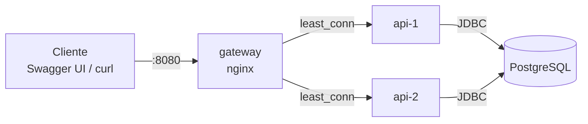
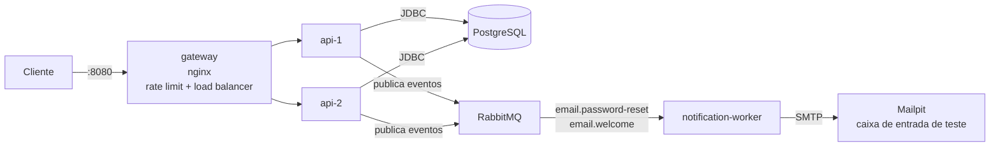
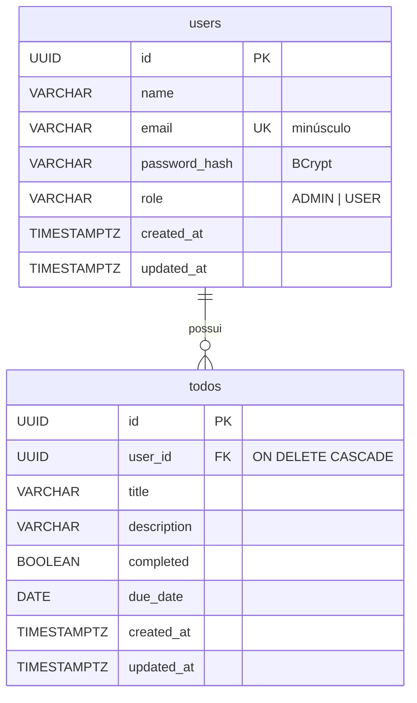

# Arquitetura

Decisões de arquitetura do projeto e o motivo de cada uma.

## Sumário

- [Contexto e opções escolhidas](#contexto-e-opções-escolhidas)
- [Visão geral](#visão-geral)
- [Componentes](#componentes)
- [Modelo de dados](#modelo-de-dados)
- [Organização do código da API](#organização-do-código-da-api)
- [Decisões](#decisões)

---

## Contexto e opções escolhidas

O trabalho pede uma API REST com persistência, orquestrada com Docker, e **exatamente 2** de 3 opções de arquitetura distribuída.

| Opção | Escolhida | Justificativa |
|-------|-----------|---------------|
| (a) API Gateway com rate limit e load balancer | Sim | Demonstra escalabilidade horizontal (várias réplicas da API) e proteção contra abuso, e se conecta diretamente à escolha de JWT stateless |
| (b) Mensageria com RabbitMQ | Sim | Tem um caso de uso real no domínio: enviar emails (código de reset de senha, boas-vindas) de forma assíncrona, sem travar a requisição |
| (c) Telemetria com Loki | Não | As opções (a) e (b) mudam o comportamento da aplicação e se complementam; telemetria seria uma camada de observação sobre o que já existe |

---

## Visão geral

### Estado atual (fases 0 a 3)



### Arquitetura alvo (após a fase 4)



---

## Componentes

| Componente            | Responsabilidade | Porta no host | Status |
|-----------------------|------------------|---------------|--------|
| `gateway`             | Porta de entrada única, rate limit, balanceamento entre `api-1` e `api-2` | 8080 | Implementado |
| `api-1`, `api-2`      | Réplicas da API: REST, autenticação, regras de negócio, persistência | nenhuma (só rede interna) | Implementado |
| `postgres`            | Banco de dados da API | 5432 | Implementado |
| `rabbitmq`            | Broker de mensagens | — | Fase 4 |
| `notification-worker` | Consome eventos e envia emails | — | Fase 4 |
| `mailpit`             | Servidor SMTP falso com interface web, para ver os emails na demonstração | — | Fase 4 |

---

## Modelo de dados



### Migrations

| Versão | Arquivo | O que faz |
|--------|---------|-----------|
| V1 | `V1__create_todos.sql` | Cria `todos` |
| V2 | `V2__create_users.sql` | Cria `users`, com email único e `CHECK` no papel |
| V3 | `V3__seed_admin_user.sql` | Insere o administrador de desenvolvimento |
| V4 | `V4__add_owner_to_todos.sql` | Adiciona `user_id` em `todos`: atribui tarefas antigas ao admin, torna obrigatório, cria FK e índice |

A V4 mostra por que migrations incrementais importam: a coluna de dono foi adicionada a uma tabela que já podia ter dados, sem apagar nada.

---

## Organização do código da API

O código é organizado **por funcionalidade** (e não por tipo de classe), para que tudo relacionado a tarefas fique junto:

```
com.todolist.api
├── auth/                 cadastro, login, emissão de token
│   ├── AuthController
│   ├── AuthService
│   ├── TokenService
│   └── dto/
├── todo/                 tarefas
│   ├── TodoController    HTTP: rotas, status, validação de entrada
│   ├── TodoService       regras: dono, filtros, transações
│   ├── TodoRepository    acesso ao banco (Spring Data JPA)
│   ├── Todo              entidade
│   ├── dto/              contratos de entrada e saída da API
│   └── mapper/           conversão entidade -> DTO
├── user/                 usuários e administração
│   ├── AdminUserController
│   ├── UserService
│   ├── UserRepository
│   ├── User
│   ├── enums/Role
│   ├── dto/
│   └── mapper/
└── shared/               código usado por várias funcionalidades
    ├── config/           Security, JWT, OpenAPI
    ├── security/         usuário autenticado, conversão do token, 401/403
    ├── exception/        exceções de domínio e tratamento global
    └── web/              paginação, validação de ordenação, header X-Instance-Id
```

Fluxo de uma requisição: `Controller` → `Service` → `Repository` → banco, com `Mapper` convertendo a entidade em DTO na volta. Entidades JPA nunca são serializadas diretamente na resposta.

---

## Decisões

### 1. Monorepo com Maven multi-módulo

Um único repositório com um `pom.xml` pai e módulos para `api`, `notification-worker` e `libs/messaging-contracts`.

- **Por quê:** a `api` (producer) e o `notification-worker` (consumer) precisam concordar no formato das mensagens. O módulo `messaging-contracts` guarda esses eventos num só lugar, e um build único garante que os dois lados compilam contra a mesma versão.
- **Consequência:** os Dockerfiles usam a raiz do repositório como contexto de build, para enxergar o pom pai e as libs compartilhadas.

### 2. Só a API tem banco; as réplicas compartilham

- `api-1` e `api-2` são cópias do **mesmo** serviço, então precisam ver os mesmos dados. Bancos separados fariam um usuário cadastrado numa instância não existir na outra.
- O `notification-worker` é stateless (recebe mensagem, envia email) e não precisa de banco. "Banco por serviço" significa que um serviço não acessa as tabelas de outro, e não que todo serviço deve ter um.

### 3. Schema versionado com Flyway e Hibernate só validando

- O Flyway aplica as migrations SQL na inicialização e registra o que já rodou em `flyway_schema_history`, incluindo um *checksum* de cada arquivo.
- O Hibernate roda com `ddl-auto: validate`: confere se as entidades batem com as tabelas e **falha na inicialização** se não baterem, mas nunca altera o schema.
- **Por quê:** o schema fica explícito, revisável e reproduzível em qualquer máquina. Com `ddl-auto: update`, o Hibernate alteraria tabelas de forma implícita e não versionada.
- **Regra:** migration aplicada é imutável, inclusive comentários, pois qualquer mudança altera o checksum e a aplicação se recusa a subir. Mudanças entram como uma nova versão (como a V4).
- **Várias réplicas:** o Flyway usa um lock no Postgres, então quando `api-1` e `api-2` sobem juntas só uma aplica as migrations; a outra espera e encontra o schema já atualizado.

### 4. Autenticação com JWT stateless

Detalhado em [AUTENTICACAO.md](AUTENTICACAO.md). Resumo: sem sessão no servidor, qualquer réplica valida qualquer token usando o mesmo `JWT_SECRET`, o que permite ao gateway distribuir requisições livremente, sem *sticky session*.

### 5. API Gateway com nginx

O `gateway` é o único serviço exposto para o cliente. As réplicas da API não publicam porta no host e só são alcançáveis pela rede interna do Docker.

Configuração: [`infra/nginx/nginx.conf`](../infra/nginx/nginx.conf).

#### Load balancing

| Mecanismo | Configuração | Efeito |
|-----------|--------------|--------|
| Algoritmo | `least_conn` | Cada requisição vai para a réplica com menos conexões ativas. Com carga equilibrada, alterna entre elas; quando uma está ocupada com requisições lentas, a outra recebe mais |
| Health check passivo | `max_fails=3 fail_timeout=10s` | Após 3 falhas, a réplica é ignorada por 10 segundos e depois volta a ser tentada |
| Failover | `proxy_next_upstream error timeout http_502 http_503` | Se uma réplica não aceita a conexão, a mesma requisição é reenviada para a outra, sem o cliente perceber |
| Detecção rápida | `proxy_connect_timeout 2s` | Uma réplica que não responde é considerada fora do ar em 2 segundos |
| DNS dinâmico | `resolver 127.0.0.11` + `resolve` | O nginx acompanha o IP de uma réplica que reinicia, sem precisar reiniciar o gateway |
| Conexões reaproveitadas | `keepalive 32` | Evita abrir uma conexão TCP nova com a API a cada requisição |

**Por que `least_conn` e não round robin?** O round robin distribui por ordem, sem considerar que algumas requisições (como login, que roda BCrypt) demoram mais. O `least_conn` direciona para quem está mais livre.

**Por que failover só em erros de conexão?** O `proxy_next_upstream` não reenvia um `POST` que já chegou à API (o nginx não repete requisições não idempotentes). Assim, uma tarefa nunca é criada duas vezes por causa de um retry.

Para ver o balanceamento acontecendo, toda resposta da API traz o header `X-Instance-Id` (`api-1` ou `api-2`), adicionado pelo `InstanceIdFilter`.

#### Rate limit

| Zona | Rotas | Limite | Rajada |
|------|-------|--------|--------|
| `api_auth` | `POST /api/auth/login`, `POST /api/auth/register` | 10 por minuto por IP | 5 |
| `api_general` | Todas | 10 por segundo por IP | 20 |

- **Algoritmo:** *leaky bucket*. As requisições "vazam" na taxa configurada; a rajada (`burst`) permite absorver picos curtos, e o `nodelay` atende essas requisições extras imediatamente em vez de enfileirá-las. Passando disso, o gateway responde `429`.
- **Rotas de autenticação têm limite mais restrito** para dificultar força bruta de senhas. As duas zonas se aplicam a elas ao mesmo tempo.
- **O `429` sai em Problem Details**, no mesmo formato JSON dos erros da API.

**Por que rate limit no gateway e não na API?**

- Se cada réplica contasse requisições por conta própria, com 2 réplicas o limite efetivo seria o dobro do configurado, e mudaria a cada réplica adicionada.
- No gateway, o limite é aplicado uma única vez, antes de a requisição chegar a qualquer instância. Requisições bloqueadas nem consomem CPU, conexão de banco ou BCrypt da API.

#### Headers repassados

O gateway envia `X-Forwarded-For`, `X-Forwarded-Proto` e `X-Forwarded-Host`. A API usa `server.forward-headers-strategy: framework` para confiar neles, de modo que as URLs geradas (header `Location` do `201 Created`, servidores listados no Swagger) apontam para `http://localhost:8080` e não para o endereço interno da réplica.

Confiar nesses headers só é seguro porque as réplicas **não** ficam expostas: toda requisição passa pelo gateway, que sobrescreve os valores enviados pelo cliente.

#### Limitações conhecidas

| Limitação | Contexto |
|-----------|----------|
| O gateway é ponto único de falha | Em produção haveria mais de uma instância de gateway atrás de um balanceador de rede (ou um load balancer gerenciado da nuvem) |
| O rate limit é por IP | Usuários atrás do mesmo NAT compartilham o limite. No Docker Desktop, todas as requisições feitas pela máquina local chegam com o mesmo IP |
| Contadores do rate limit ficam na memória do nginx | Com vários gateways, cada um contaria separadamente; seria preciso um armazenamento compartilhado |

### 6. Emails assíncronos via RabbitMQ *(fase 4)*

- Enviar email dentro da requisição deixaria o usuário esperando o servidor SMTP e faria a requisição falhar se ele estivesse fora do ar.
- Com fila, a API publica o evento e responde na hora. O worker envia quando puder, e as mensagens ficam guardadas na fila se o worker estiver parado.
- Duas filas com propósitos distintos: `email.password-reset` e `email.welcome`, cada uma com fila de mensagens mortas (DLQ) para falhas.
- O evento só será publicado **depois do commit** da transação, para não enviar email de uma operação que foi desfeita.

### 7. Erros no padrão RFC 9457 (Problem Details)

- Todo erro sai no mesmo formato JSON (`title`, `status`, `detail`, `instance`): os da API, os `401`/`403` gerados pelo Spring Security antes de chegar ao controller, e os `429`/`503` gerados pelo próprio gateway.
- **Por quê:** o cliente trata erros de um único jeito, e o formato é um padrão da IETF suportado nativamente pelo Spring.

### 8. Paginação com contrato próprio e ordenação por lista permitida

- As listagens retornam um `PageResponse` próprio (`content`, `page`, `size`, `totalElements`, `totalPages`) em vez de serializar o objeto interno do Spring Data, cujo formato não é estável entre versões.
- `sort` só aceita campos explicitamente permitidos. Sem isso, um valor malformado chegava ao banco e gerava `500`, e seria possível ordenar por campos que o cliente não pode ler (ex.: `owner.passwordHash`) e deduzir valores pela ordem.

### 9. Recurso de outro usuário responde `404`

Responder `403` confirmaria que o id existe. Com `404`, a API não revela a existência de tarefas alheias.

### 10. DTOs e mappers explícitos

- Requisições e respostas usam `record`s próprios (`CreateTodoRequest`, `TodoResponse`...), nunca a entidade.
- **Por quê:** evita expor campos internos (como `passwordHash`), impede que o cliente altere campos que não deveria (como `role` no cadastro) e desacopla o contrato da API do schema do banco.
- A conversão fica em mappers dedicados (`TodoMapper`, `UserMapper`), mantendo os DTOs como dados puros.

### 11. Docker

| Prática | Motivo |
|---------|--------|
| Build multi-stage (JDK para compilar, JRE para rodar) | Imagem final menor e sem ferramentas de build |
| Imagens Alpine | Menor tamanho |
| Usuário não-root no container da API | Reduz impacto de uma eventual falha de segurança |
| Cache do Maven no build (`--mount=type=cache`) | Rebuilds bem mais rápidos |
| Réplicas definidas com âncoras YAML (`x-api`) | `api-1` e `api-2` compartilham a mesma imagem e configuração; só o `INSTANCE_ID` muda |
| `healthcheck` em cada serviço + `depends_on: service_healthy` | Cada serviço só inicia quando suas dependências estão prontas de fato: API depois do banco, gateway depois das duas réplicas |
| Apenas gateway e banco publicam portas | As réplicas só são acessíveis pelo gateway, garantindo que rate limit e balanceamento não sejam contornados |
| Valores padrão para todas as variáveis | `docker compose up` funciona sem criar `.env`, como exige o enunciado |
| Um Dockerfile por componente, inclusive infraestrutura | Exigência do enunciado; também deixa explícita a versão de cada imagem |

### 12. Testes de integração com Testcontainers

- Os testes sobem um PostgreSQL real e descartável em vez de um banco em memória (H2).
- **Por quê:** as migrations, os tipos (`UUID`, `TIMESTAMPTZ`), as constraints e o `ON DELETE CASCADE` são testados exatamente como rodam em produção. Um H2 aceitaria SQL que o Postgres recusaria, e vice-versa.
- Os testes exercitam a API pela camada HTTP (MockMvc) com tokens JWT reais, cobrindo autenticação, autorização e regras de negócio de ponta a ponta.
- O comportamento do gateway (balanceamento, rate limit, failover) é verificado pelos scripts de demonstração em `scripts/`, contra a aplicação rodando no Docker Compose.
