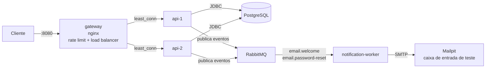
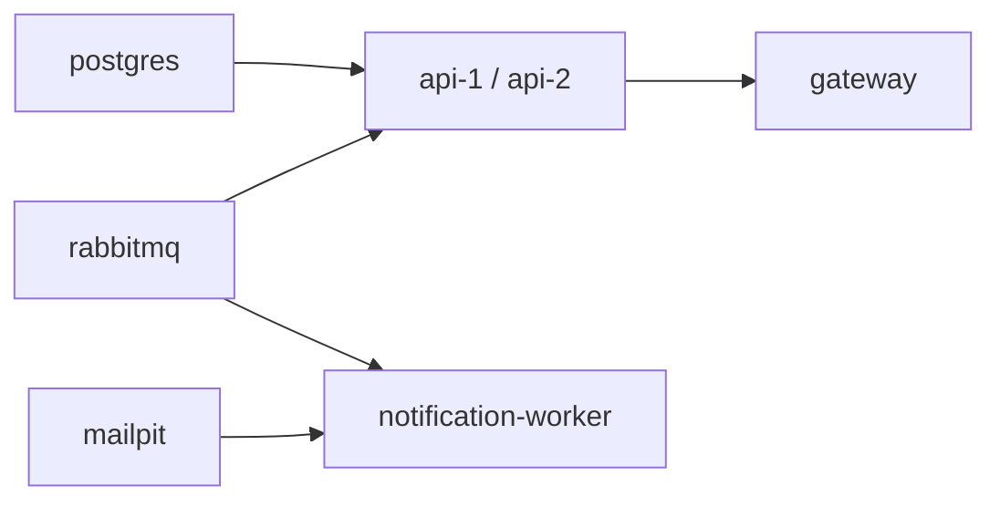
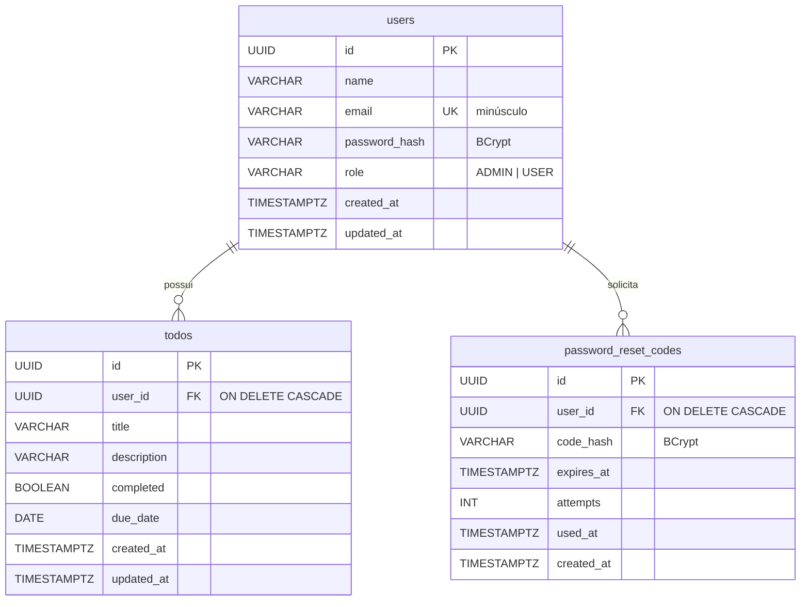
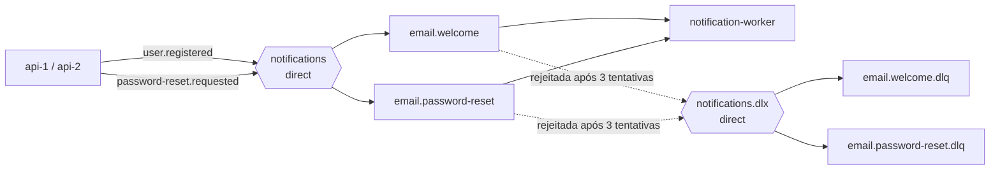
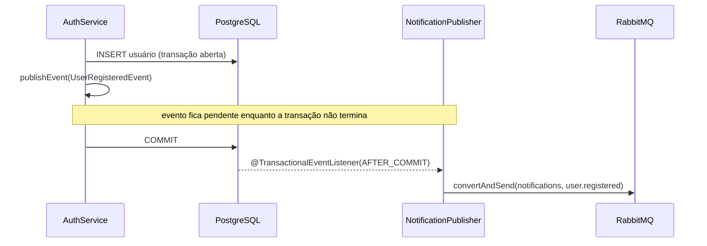

# Arquitetura

Decisões de arquitetura do projeto e o motivo de cada uma.

## Sumário

- [Contexto e opções escolhidas](#contexto-e-opções-escolhidas)
- [Visão geral](#visão-geral)
- [Componentes](#componentes)
- [Modelo de dados](#modelo-de-dados)
- [Organização do código](#organização-do-código)
- [Decisões](#decisões)

---

## Contexto e opções escolhidas

O trabalho pede uma API REST com persistência, orquestrada com Docker, e **exatamente 2** de 3 opções de arquitetura distribuída.

| Opção | Escolhida | Justificativa |
|-------|-----------|---------------|
| (a) API Gateway com rate limit e load balancer | Sim | Demonstra escalabilidade horizontal (várias réplicas da API) e proteção contra abuso, e se conecta diretamente à escolha de JWT stateless |
| (b) Mensageria com RabbitMQ | Sim | Tem um caso de uso real no domínio: enviar emails (boas-vindas e código de redefinição de senha) de forma assíncrona, sem travar a requisição |
| (c) Telemetria com Loki | Não | As opções (a) e (b) mudam o comportamento da aplicação e se complementam; telemetria seria uma camada de observação sobre o que já existe |

---

## Visão geral



---

## Componentes

| Componente            | Responsabilidade | Porta no host |
|-----------------------|------------------|---------------|
| `gateway`             | Porta de entrada única, rate limit, balanceamento entre `api-1` e `api-2` | 8080 |
| `api-1`, `api-2`      | Réplicas da API: REST, autenticação, regras de negócio, persistência e publicação de eventos (producer) | nenhuma (só rede interna) |
| `postgres`            | Banco de dados da API | 5432 |
| `rabbitmq`            | Broker de mensagens | 5672 (AMQP), 15672 (painel) |
| `notification-worker` | Consome os eventos e envia os emails (consumer) | nenhuma |
| `mailpit`             | Servidor SMTP falso com caixa de entrada web, para ver os emails em desenvolvimento | 8025 (SMTP 1025 interno) |

Ordem de inicialização garantida por `healthcheck` + `depends_on: service_healthy`:



---

## Modelo de dados



### Migrations

| Versão | Arquivo | O que faz |
|--------|---------|-----------|
| V1 | `V1__create_todos.sql` | Cria `todos` |
| V2 | `V2__create_users.sql` | Cria `users`, com email único e `CHECK` no papel |
| V3 | `V3__seed_admin_user.sql` | Insere o administrador de desenvolvimento |
| V4 | `V4__add_owner_to_todos.sql` | Adiciona `user_id` em `todos`: atribui tarefas antigas ao admin, torna obrigatório, cria FK |
| V5 | `V5__create_password_reset_codes.sql` | Cria `password_reset_codes` (hash do código, validade, tentativas, uso) |

A V4 mostra por que migrations incrementais importam: a coluna de dono foi adicionada a uma tabela que já podia ter dados, sem apagar nada.

---

## Organização do código

O código é organizado **por funcionalidade** (e não por tipo de classe), para que tudo relacionado a um assunto fique junto.

### API

```
com.todolist.api
├── auth/                 cadastro, login, emissão de token, redefinição de senha
│   ├── AuthController
│   ├── AuthService
│   ├── TokenService
│   ├── PasswordResetService
│   ├── PasswordResetCode (+ repository)
│   └── dto/
├── notification/         producer: envia os eventos ao RabbitMQ após o commit
│   └── NotificationPublisher
├── todo/                 tarefas
│   ├── TodoController    HTTP: rotas, status, validação de entrada
│   ├── TodoService       regras: dono, filtros, transações
│   ├── TodoRepository    acesso ao banco (Spring Data JPA)
│   ├── Todo              entidade
│   ├── dto/              contratos de entrada e saída da API
│   └── mapper/           conversão entidade -> DTO
├── user/                 usuários e administração
└── shared/               código usado por várias funcionalidades
    ├── config/           Security, JWT, OpenAPI, mensageria
    ├── security/         usuário autenticado, conversão do token, 401/403
    ├── exception/        exceções de domínio e tratamento global
    └── web/              paginação, validação de ordenação, header X-Instance-Id
```

Fluxo de uma requisição: `Controller` → `Service` → `Repository` → banco, com `Mapper` convertendo a entidade em DTO na volta. Entidades JPA nunca são serializadas diretamente na resposta.

### Worker e contratos

```
com.todolist.worker                         (services/notification-worker)
├── listener/NotificationListener           um @RabbitListener por fila
└── email/EmailService                      monta o HTML (Thymeleaf) e envia por SMTP

com.todolist.contracts                      (libs/messaging-contracts)
├── NotificationTopology                    nomes de exchanges, routing keys e filas
├── event/                                  UserRegisteredEvent, PasswordResetRequestedEvent
└── config/MessagingConfiguration           declaração da topologia + conversor JSON
```

---

## Decisões

### 1. Monorepo com Maven multi-módulo

Um único repositório com um `pom.xml` pai e módulos para `api`, `notification-worker` e `libs/messaging-contracts`.

- **Por quê:** a `api` (producer) e o `notification-worker` (consumer) precisam concordar no formato das mensagens e na topologia do RabbitMQ. O módulo `messaging-contracts` guarda os eventos, os nomes das filas e a declaração da topologia num só lugar, e um build único garante que os dois lados compilam contra a mesma versão.
- **Consequência:** os Dockerfiles usam a raiz do repositório como contexto de build, para enxergar o pom pai e as libs compartilhadas.

### 2. Só a API tem banco; as réplicas compartilham

- `api-1` e `api-2` são cópias do **mesmo** serviço, então precisam ver os mesmos dados. Bancos separados fariam um usuário cadastrado numa instância não existir na outra.
- O `notification-worker` é stateless: tudo de que precisa para enviar um email vem na própria mensagem. "Banco por serviço" significa que um serviço não acessa as tabelas de outro, e não que todo serviço deve ter um.

### 3. Schema versionado com Flyway e Hibernate só validando

- O Flyway aplica as migrations SQL na inicialização e registra o que já rodou em `flyway_schema_history`, incluindo um *checksum* de cada arquivo.
- O Hibernate roda com `ddl-auto: validate`: confere se as entidades batem com as tabelas e **falha na inicialização** se não baterem, mas nunca altera o schema.
- **Por quê:** o schema fica explícito, revisável e reproduzível em qualquer máquina. Com `ddl-auto: update`, o Hibernate alteraria tabelas de forma implícita e não versionada.
- **Regra:** migration aplicada é imutável, inclusive comentários, pois qualquer mudança altera o checksum e a aplicação se recusa a subir. Mudanças entram como uma nova versão (como a V4 e a V5).
- **Várias réplicas:** o Flyway usa um lock no Postgres, então quando `api-1` e `api-2` sobem juntas só uma aplica as migrations; a outra espera e encontra o schema já atualizado.

### 4. Autenticação com JWT stateless

Detalhado em [AUTENTICACAO.md](AUTENTICACAO.md). Resumo: sem sessão no servidor, qualquer réplica valida qualquer token usando o mesmo `JWT_SECRET`, o que permite ao gateway distribuir requisições livremente, sem *sticky session*.

### 5. API Gateway com nginx

O `gateway` é o único serviço exposto para os clientes da API. As réplicas não publicam porta no host e só são alcançáveis pela rede interna do Docker.

Configuração: [`infra/nginx/nginx.conf`](../infra/nginx/nginx.conf).

#### Load balancing

| Mecanismo | Configuração | Efeito |
|-----------|--------------|--------|
| Algoritmo | `least_conn` | Cada requisição vai para a réplica com menos conexões ativas. Em empate, alterna entre elas |
| Health check passivo | `max_fails=3 fail_timeout=10s` | Após 3 falhas, a réplica é ignorada por 10 segundos e depois volta a ser tentada |
| Failover | Comportamento padrão do nginx (`proxy_next_upstream error timeout`) | Se uma réplica não aceita a conexão, a mesma requisição é reenviada para a outra, sem o cliente perceber |
| Detecção rápida | `proxy_connect_timeout 2s` | Uma réplica que não responde é considerada fora do ar em 2 segundos (o padrão seria 60s) |

**Por que `least_conn` e não round robin?** O round robin distribui por ordem, sem considerar que algumas requisições (como login, que roda BCrypt) demoram mais. O `least_conn` direciona para quem está mais livre.

**Por que failover só em erros de conexão?** O nginx não reenvia um `POST` que já chegou à API (não repete requisições não idempotentes). Assim, uma tarefa nunca é criada duas vezes por causa de um retry.

Para ver o balanceamento acontecendo, toda resposta da API traz o header `X-Instance-Id` (`api-1` ou `api-2`), adicionado pelo `InstanceIdFilter`.

#### Rate limit

| Zona | Rotas | Limite | Rajada |
|------|-------|--------|--------|
| `api_auth` | `POST /api/auth/login`, `register`, `forgot-password`, `reset-password` | 10 por minuto por IP | 5 |
| `api_general` | Todas | 10 por segundo por IP | 20 |

- **Algoritmo:** *leaky bucket*. As requisições "vazam" na taxa configurada; a rajada (`burst`) permite absorver picos curtos, e o `nodelay` atende essas requisições extras imediatamente em vez de enfileirá-las. Passando disso, o gateway responde `429`.
- **Rotas de autenticação têm limite mais restrito** para dificultar força bruta de senhas e de códigos de redefinição, e o disparo de emails em massa.
- **O `429` sai em Problem Details**, no mesmo formato JSON dos erros da API.

**Por que rate limit no gateway e não na API?**

- Se cada réplica contasse requisições por conta própria, com 2 réplicas o limite efetivo seria o dobro do configurado, e mudaria a cada réplica adicionada.
- No gateway, o limite é aplicado uma única vez, antes de a requisição chegar a qualquer instância. Requisições bloqueadas nem consomem CPU, conexão de banco ou BCrypt da API.

#### Headers repassados

O gateway envia `X-Forwarded-For`, `X-Forwarded-Proto` e `X-Forwarded-Host`. A API usa `server.forward-headers-strategy: framework` para confiar neles, de modo que as URLs geradas (header `Location` do `201 Created`, servidores listados no Swagger) apontam para `http://localhost:8080` e não para o endereço interno da réplica.

Confiar nesses headers só é seguro porque as réplicas **não** ficam expostas: toda requisição passa pelo gateway, que sobrescreve os valores enviados pelo cliente.

#### Limitações conhecidas do gateway

| Limitação | Contexto |
|-----------|----------|
| O gateway é ponto único de falha | Em produção haveria mais de uma instância de gateway atrás de um balanceador de rede (ou um load balancer gerenciado da nuvem) |
| O rate limit é por IP | Usuários atrás do mesmo NAT compartilham o limite. No Docker Desktop, todas as requisições feitas pela máquina local chegam com o mesmo IP |
| Contadores do rate limit ficam na memória do nginx | Com vários gateways, cada um contaria separadamente; seria preciso um armazenamento compartilhado |

### 6. Mensageria com RabbitMQ

A API é o **producer**, o `notification-worker` é o **consumer**, e os dois se comunicam apenas por mensagens: nenhum conhece o endereço do outro.

#### Topologia



| Elemento | Tipo | Papel |
|----------|------|-------|
| `notifications` | Exchange direct | Recebe os eventos da API e roteia pela routing key |
| `user.registered` | Routing key | Evento de cadastro concluído |
| `password-reset.requested` | Routing key | Evento de pedido de redefinição de senha |
| `email.welcome` | Fila durável | Emails de boas-vindas |
| `email.password-reset` | Fila durável | Emails com o código de 6 dígitos |
| `notifications.dlx` | Exchange direct | *Dead-letter exchange*: recebe as mensagens rejeitadas pelas filas acima |
| `email.welcome.dlq`, `email.password-reset.dlq` | Filas duráveis | Mensagens que falharam, guardadas para análise e reprocessamento |

**Duas filas com propósitos diferentes**, como exige o enunciado: uma para comunicação de boas-vindas, outra para um fluxo de segurança (código de redefinição). Filas separadas também isolam os problemas: um volume grande de cadastros não atrasa os códigos de redefinição, e cada fila tem sua própria DLQ.

**Eventos, não comandos.** A API publica *o que aconteceu* (`user.registered`), e não *o que fazer* ("enviar email"). Para adicionar um novo consumidor (por exemplo, um serviço de auditoria), basta criar uma fila ligada à mesma routing key, sem alterar a API.

**Topologia declarada em código.** A API e o worker importam a mesma `MessagingConfiguration` (em `libs/messaging-contracts`). As declarações são idempotentes, então qualquer ordem de inicialização funciona, e os testes com um RabbitMQ vazio (Testcontainers) recebem exatamente a mesma topologia. A alternativa de um `definitions.json` carregado pelo broker duplicaria os nomes em dois lugares e não valeria nos testes.

#### Producer: publicar só depois do commit



- Os serviços publicam um evento do Spring **dentro** da transação, e o `NotificationPublisher` só envia ao RabbitMQ **depois do commit**.
- **Por quê:** se a mensagem fosse enviada antes e a transação falhasse, o usuário receberia um email de boas-vindas de uma conta que não existe, ou um código que não foi gravado.
- **Se o RabbitMQ estiver fora do ar nesse momento:** o erro é registrado no log e a requisição **continua com sucesso**, porque o dado já está no banco. A notificação se perde. A conexão tem timeout de 5s para não travar a requisição.
- **Evolução possível:** o padrão *Transactional Outbox* (gravar o evento numa tabela na mesma transação e publicar a partir dela) eliminaria essa perda.
- **A saúde da API não depende do RabbitMQ** (`management.health.rabbit.enabled: false`): login e tarefas continuam funcionando com o broker fora; só as notificações são afetadas. Caso contrário, uma queda do RabbitMQ tiraria as duas réplicas do gateway.

#### Consumer: confirmação, retry e DLQ

| Situação | Comportamento |
|----------|---------------|
| Email enviado | O listener termina sem exceção e a mensagem é confirmada (*ack*) e removida da fila |
| Falha no envio (ex.: SMTP fora) | Nova tentativa após 1s e depois após 2s (3 tentativas no total) |
| Servidor SMTP não responde | A conexão desiste em 5s (`mail.smtp.connectiontimeout`) e conta como falha. Sem esse timeout, o JavaMail esperaria para sempre: o consumer ficaria travado e o retry e a DLQ nunca entrariam em ação |
| Falhou nas 3 tentativas | A mensagem é rejeitada sem voltar para a fila (`default-requeue-rejected: false`) e o RabbitMQ a move para a `.dlq` |
| Worker parado | As mensagens ficam guardadas nas filas duráveis e são processadas quando ele voltar |
| Código de redefinição já expirado ao ser consumido | O worker descarta a mensagem sem enviar o email |

**Por que não devolver a mensagem para a fila indefinidamente?** Uma mensagem que sempre falha (*poison message*) seria entregue de novo sem parar, consumindo o worker e atrasando as outras. A DLQ tira essa mensagem do caminho sem perdê-la.

**Reprocessamento:** a imagem do RabbitMQ habilita os plugins de *shovel*, que adicionam **Move messages** ao painel. Depois de corrigir o problema, as mensagens da `.dlq` podem ser enviadas de volta para a fila original.

**Saúde do worker:** depende do RabbitMQ (sem broker o worker não faz nada), mas **não** do servidor de email (`management.health.mail.enabled: false`), porque falhas de envio já são tratadas por retry e DLQ.

#### Serialização

- As mensagens são JSON (`JacksonJsonMessageConverter`). O producer grava o tipo do evento num header, e o consumer usa esse header para desserializar.
- O conversor só aceita tipos do pacote `com.todolist.contracts.event`. Sem essa restrição, uma mensagem forjada poderia fazer o consumer instanciar classes arbitrárias (ataque de desserialização).

#### Mailpit

Servidor SMTP de desenvolvimento que captura todos os emails e os exibe numa caixa de entrada web. Em produção, bastaria apontar `SPRING_MAIL_HOST`, porta e credenciais para um provedor real, sem alterar código.

#### Limitações conhecidas da mensageria

| Limitação | Contexto |
|-----------|----------|
| Evento perdido se o broker cair no instante da publicação | Mitigável com *Transactional Outbox* |
| Entrega "pelo menos uma vez" | Se o worker cair depois de enviar o email e antes de confirmar a mensagem, ela é reentregue e o email sai duplicado. Para emails isso é aceitável; para operações críticas, o consumer precisaria ser idempotente (ex.: registrar ids de eventos já processados) |
| Retry em memória | Durante as esperas entre tentativas, a thread do consumer fica ocupada. Para volumes maiores, filas de espera com TTL fariam o retry sem bloquear |

### 7. Erros no padrão RFC 9457 (Problem Details)

- Todo erro sai no mesmo formato JSON (`title`, `status`, `detail`, `instance`): os da API, os `401`/`403` gerados pelo Spring Security antes de chegar ao controller, e o `429` gerado pelo próprio gateway.
- **Por quê:** o cliente trata erros de um único jeito, e o formato é um padrão da IETF suportado nativamente pelo Spring.

### 8. Paginação com contrato próprio e ordenação por lista permitida

- As listagens retornam um `PageResponse` próprio (`content`, `page`, `size`, `totalElements`, `totalPages`) em vez de serializar o objeto interno do Spring Data, cujo formato não é estável entre versões.
- `sort` só aceita campos explicitamente permitidos. Sem isso, um valor malformado chegava ao banco e gerava `500`, e seria possível ordenar por campos que o cliente não pode ler (ex.: `owner.passwordHash`) e deduzir valores pela ordem.

### 9. Recurso de outro usuário responde `404`

Responder `403` confirmaria que o id existe. Com `404`, a API não revela a existência de tarefas alheias.

### 10. DTOs e mappers explícitos

- Requisições e respostas usam `record`s próprios (`CreateTodoRequest`, `TodoResponse`...), nunca a entidade.
- **Por quê:** evita expor campos internos (como `passwordHash`), impede que o cliente altere campos que não deveria (como `role` no cadastro) e desacopla o contrato da API do schema do banco.
- A conversão fica em mappers dedicados (`TodoMapper`, `UserMapper`), mantendo os DTOs como dados puros.

### 11. Docker

| Prática | Motivo |
|---------|--------|
| Build multi-stage (JDK para compilar, JRE para rodar) | Imagem final menor e sem ferramentas de build |
| Imagens Alpine | Menor tamanho |
| Usuário não-root nos containers Java | Reduz impacto de uma eventual falha de segurança |
| Cache do Maven no build (`--mount=type=cache,sharing=locked`) | Rebuilds bem mais rápidos; `locked` evita que os builds da API e do worker, em paralelo, corrompam o cache |
| Réplicas definidas com âncoras YAML (`x-api`) | `api-1` e `api-2` compartilham a mesma imagem e configuração; só o `INSTANCE_ID` muda |
| `healthcheck` em cada serviço + `depends_on: service_healthy` | Cada serviço só inicia quando suas dependências estão prontas de fato |
| As réplicas da API não publicam portas | Só são acessíveis pelo gateway, garantindo que rate limit e balanceamento não sejam contornados |
| `hostname` fixo no RabbitMQ | O RabbitMQ guarda os dados por nome do nó (`rabbit@<hostname>`); sem nome fixo, recriar o container ignoraria o volume |
| Valores padrão para todas as variáveis | `docker compose up` funciona sem criar `.env`, como exige o enunciado |
| Um Dockerfile por componente, inclusive infraestrutura | Exigência do enunciado; também deixa explícita a versão de cada imagem e permite customizá-las (ex.: plugins do RabbitMQ) |

### 12. Testes de integração com Testcontainers

- Os testes sobem PostgreSQL e RabbitMQ reais e descartáveis em vez de substitutos em memória.
- **Por quê:** migrations, tipos (`UUID`, `TIMESTAMPTZ`), constraints, `ON DELETE CASCADE`, topologia de filas, serialização das mensagens e dead-lettering são testados exatamente como rodam na aplicação.
- **API:** os testes exercitam a camada HTTP (MockMvc) com tokens JWT reais e leem as mensagens publicadas direto das filas, validando o fluxo de redefinição de senha com o código que foi de fato publicado.
- **Worker:** os testes publicam eventos no RabbitMQ e verificam os emails gerados (com um `JavaMailSender` que guarda as mensagens em memória), incluindo o caminho de falha até a DLQ.
- O comportamento do gateway (balanceamento, rate limit, failover) é verificado pelos scripts de demonstração em `scripts/`, contra a aplicação rodando no Docker Compose.
