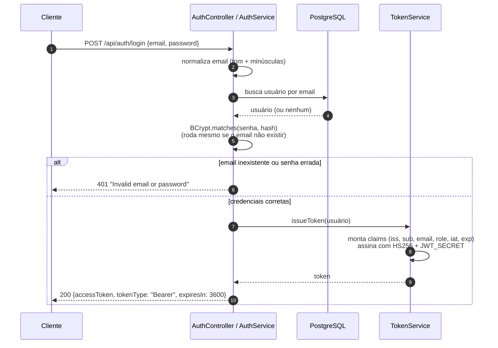
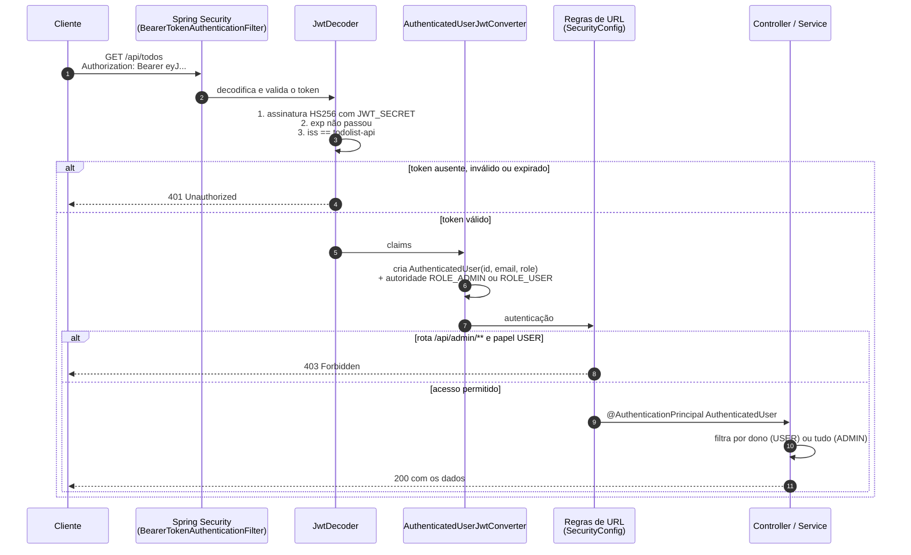
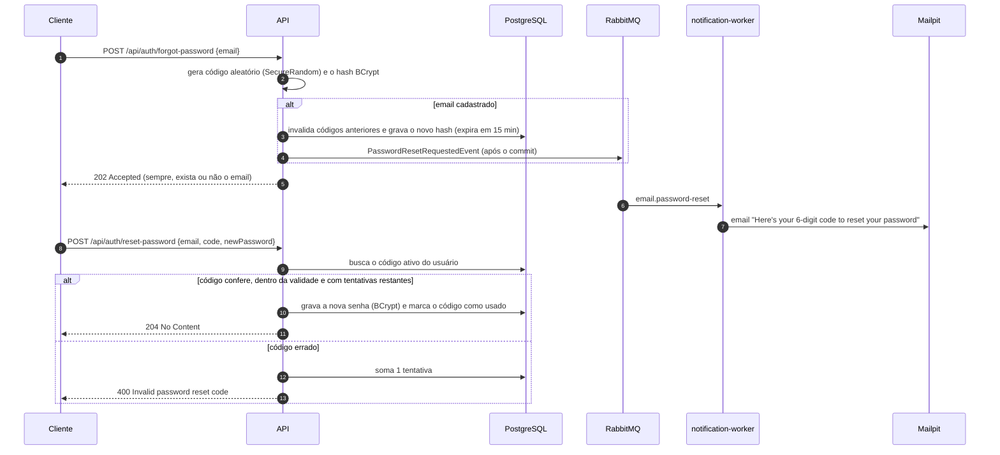

# Autenticação e autorização

Este documento explica como a API identifica quem está chamando (autenticação), o que cada pessoa pode fazer (autorização) e por que as escolhas foram feitas assim.

## Sumário

- [Visão geral](#visão-geral)
- [O que é um JWT](#o-que-é-um-jwt)
- [Anatomia do token desta API](#anatomia-do-token-desta-api)
- [Fluxo de login](#fluxo-de-login)
- [Fluxo de uma requisição autenticada](#fluxo-de-uma-requisição-autenticada)
- [Autorização em duas camadas](#autorização-em-duas-camadas)
- [Por que JWT stateless](#por-que-jwt-stateless)
- [Por que HS256](#por-que-hs256)
- [Proteções implementadas](#proteções-implementadas)
- [Redefinição de senha](#redefinição-de-senha)
- [Limitações conhecidas](#limitações-conhecidas)
- [Configuração](#configuração)
- [Onde está no código](#onde-está-no-código)

---

## Visão geral

| Aspecto        | Decisão |
|----------------|---------|
| Mecanismo      | JWT (JSON Web Token) enviado no header `Authorization: Bearer <token>` |
| Estado         | Stateless: o servidor não guarda sessão |
| Assinatura     | HMAC-SHA256 (HS256) com a chave `JWT_SECRET` |
| Validade       | 1 hora |
| Papéis         | `ADMIN` e `USER` |
| Senhas         | BCrypt (custo 10) |
| Implementação  | Spring Security + OAuth2 Resource Server (Nimbus JOSE) |

---

## O que é um JWT

Um JWT é uma string com três partes em Base64URL, separadas por pontos:

```
eyJhbGciOiJIUzI1NiJ9 . eyJpc3MiOiJ0b2RvbGlzdC1hcGkiLCJzdWIi... . Xk3v9...assinatura
       header                        payload                          signature
```

- **Header:** qual algoritmo assinou o token.
- **Payload:** os dados (*claims*) sobre o usuário.
- **Signature:** `HMAC-SHA256(header + "." + payload, JWT_SECRET)`.

A assinatura é o que dá segurança. Se alguém alterar o payload (por exemplo, trocar `"role": "USER"` por `"ADMIN"`), a assinatura deixa de bater e a API recusa o token. Só quem conhece o `JWT_SECRET` consegue gerar uma assinatura válida.

> O payload é apenas **codificado**, não criptografado. Qualquer pessoa com o token consegue ler o conteúdo. Por isso o token nunca carrega senha nem dados sensíveis.

---

## Anatomia do token desta API

Header e payload reais de um token do administrador, decodificados:

```json
{ "alg": "HS256" }
```

```json
{
  "iss": "todolist-api",
  "sub": "25383800-817e-492b-a713-006ef30662bc",
  "email": "admin@todolist.com",
  "role": "ADMIN",
  "iat": 1789345311,
  "exp": 1789348911
}
```

| Claim   | Significado | Uso na API |
|---------|-------------|------------|
| `iss`   | *Issuer*, quem emitiu | Deve ser `todolist-api`; outro valor é recusado |
| `sub`   | *Subject*, o id do usuário | Identifica o dono das tarefas |
| `email` | Email do usuário | Informativo |
| `role`  | Papel (`ADMIN` ou `USER`) | Decide o acesso às rotas e às tarefas de outros |
| `iat`   | *Issued at*, emissão (segundos desde 1970) | Informativo |
| `exp`   | *Expiration*, expiração | Após esse instante o token é recusado (`exp - iat = 3600` s) |

Para inspecionar um token durante o desenvolvimento, dá para decodificar o payload no terminal:

```bash
echo "$TOKEN" | cut -d. -f2 | tr '_-' '/+' | base64 -d
```

---

## Fluxo de login



---

## Fluxo de uma requisição autenticada



Em nenhum momento dessa validação a API consulta o banco para saber quem é o usuário: tudo vem do token assinado.

---

## Autorização em duas camadas

### 1. Regras de rota, em `SecurityConfig`

Avaliadas antes de qualquer controller.

| Rota                                                    | Regra |
|---------------------------------------------------------|-------|
| `POST /api/auth/register`, `POST /api/auth/login`       | Pública |
| `/swagger-ui/**`, `/v3/api-docs/**`, `/actuator/health` | Pública |
| `/api/admin/**`                                         | Exige `ROLE_ADMIN`, senão `403` |
| Qualquer outra rota                                     | Exige token válido, senão `401` |

### 2. Regras de dono, em `TodoService`

Rotas de tarefas estão abertas a qualquer usuário autenticado, mas o serviço filtra os dados:

- `USER`: as consultas incluem o `id` do token (`findByOwnerId`, `findByIdAndOwnerId`). A tarefa de outra pessoa simplesmente não é encontrada, gerando `404`.
- `ADMIN`: consultas sem esse filtro.

**Por que `404` e não `403`?** Um `403` confirmaria que o id existe e só não é seu. Com `404`, um usuário não consegue descobrir ids de tarefas alheias testando valores.

### Regras de negócio da administração, em `UserService`

- Um administrador não pode alterar o próprio papel nem remover a própria conta (`422`). Isso evita que o último admin se tranque para fora do sistema.

---

## Por que JWT stateless

A alternativa clássica é **sessão no servidor**: após o login, o servidor guarda "sessão X = usuário Y" em memória e devolve um cookie.

O problema aparece com **duas instâncias da API atrás de um load balancer**, exatamente o cenário deste projeto (`api-1` e `api-2` atrás do gateway nginx):

| Sessão em memória | JWT stateless |
|-------------------|---------------|
| Login feito na `api-1` fica guardado só na `api-1` | Nada é guardado no servidor |
| Se a próxima requisição cair na `api-2`, o usuário "não está logado" | Qualquer instância valida o token sozinha, só com o `JWT_SECRET` |
| Exige *sticky session* ou um armazenamento compartilhado (ex.: Redis) | O load balancer pode distribuir livremente |

Além disso, cada requisição é validada só com CPU (conferir assinatura), sem ida ao banco.

O custo dessa escolha está em [limitações conhecidas](#limitações-conhecidas).

---

## Por que HS256

| HS256 (simétrico) | RS256 (assimétrico) |
|-------------------|---------------------|
| Uma única chave assina e valida | Chave privada assina; chave pública valida |
| Simples de configurar (uma variável de ambiente) | Exige gerar e distribuir par de chaves |
| Quem valida também conseguiria emitir tokens | Serviços podem validar sem conseguir emitir |

Nesta arquitetura, **quem emite e quem valida é o mesmo serviço** (as réplicas da `api`). O `notification-worker` não recebe requisições HTTP de usuários, então não precisa validar tokens. Nesse cenário o HS256 é suficiente. RS256 passaria a valer a pena se outros serviços precisassem validar tokens sem poder emiti-los.

---

## Proteções implementadas

| Proteção | Como |
|----------|------|
| Senhas nunca em texto puro | BCrypt com *salt* aleatório por senha (custo 10) |
| Limite do BCrypt respeitado | Senha entre 8 e 72 caracteres (o BCrypt ignora o que passa de 72 bytes) |
| Sem enumeração de emails no login | Mesma resposta `401` para email inexistente e senha errada |
| Sem enumeração por tempo de resposta | O BCrypt roda mesmo quando o email não existe (contra um hash falso), então as duas respostas demoram o mesmo |
| Sem escalada de privilégio no cadastro | `register` ignora qualquer campo `role`; toda conta nasce `USER` |
| Email único sem ambiguidade | Emails normalizados (`trim` + minúsculas) e restrição `UNIQUE` no banco, inclusive contra cadastros simultâneos |
| Tokens de outra origem recusados | Validação do `iss` além da assinatura e da expiração |
| Token adulterado recusado | Assinatura HS256 conferida em toda requisição |
| Sem vazamento por ordenação | `sort` só aceita campos de uma lista permitida (ex.: impede `sort=owner.passwordHash`) |
| Sem acesso cruzado entre usuários | Filtro por dono no serviço, com `404` |
| Sempre existe um admin | Admin não altera o próprio papel nem remove a própria conta |
| Sem CSRF | API sem cookies nem sessão; o token vai no header, então CSRF não se aplica e está desabilitado |
| Erros padronizados | `401` e `403` no mesmo formato Problem Details dos demais erros |

---

## Redefinição de senha

Quem esqueceu a senha recebe por email um **código de 6 dígitos** e o usa para definir uma nova. O envio do email é assíncrono, via RabbitMQ (detalhes em [ARQUITETURA.md](ARQUITETURA.md#6-mensageria-com-rabbitmq)).



| Regra | Como | Por quê |
|-------|------|---------|
| Resposta sempre `202` | `forgot-password` responde igual para email cadastrado ou não, e gera e faz hash do código nos dois casos | Não revela quais emails existem, nem pelo conteúdo nem pelo tempo de resposta |
| Código aleatório de verdade | `SecureRandom`, 6 dígitos (1 milhão de combinações) | `Random` comum é previsível |
| Código nunca em texto puro no banco | Apenas o hash BCrypt fica em `password_reset_codes` | Um vazamento do banco não entrega códigos válidos |
| Validade curta | 15 minutos | Limita a janela de ataque |
| Máximo de 5 tentativas por código | Cada código errado soma uma tentativa; na quinta, o código é bloqueado | Com 5 chutes em 1 milhão, adivinhar é inviável |
| Tentativa errada é gravada mesmo com erro | `@Transactional(noRollbackFor = InvalidPasswordResetCodeException.class)` | Sem isso, a exceção desfaria a transação e o contador nunca subiria |
| Uso único | O código é marcado como usado após a troca | Um email antigo não pode ser reutilizado |
| Pedido novo invalida o anterior | Só o código mais recente é aceito | Evita vários códigos válidos ao mesmo tempo |
| Mesma resposta para todo erro | Email inexistente, código errado, expirado, usado ou bloqueado: todos `400` com a mesma mensagem | Não informa qual parte do palpite estava certa |
| Rate limit no gateway | `forgot-password` e `reset-password` estão na zona restrita (10/min por IP) | Dificulta tanto força bruta de códigos quanto disparo de emails em massa |
| Email não enviado se expirou na fila | O worker descarta o evento se o código já venceu | Se o worker ficou parado, não faz sentido enviar um código inútil |

---

## Limitações conhecidas

São consequências diretas de o token ser stateless. Estão documentadas porque são perguntas prováveis na apresentação.

| Limitação | Efeito | Como evoluir |
|-----------|--------|--------------|
| Não há logout no servidor | Um token continua válido até expirar, mesmo se o cliente "sair" | Lista de tokens revogados (ex.: Redis), consultada a cada requisição |
| Troca de papel não é imediata | Quem foi promovido ou rebaixado mantém o papel antigo até fazer login de novo (no máximo 1h) | Guardar uma versão do usuário no token e comparar com o banco, ou reduzir a validade |
| Usuário removido com token ativo | O token ainda autentica, mas as operações que buscam o usuário respondem `404` | Mesmo mecanismo de revogação |
| Sem *refresh token* | Após 1h é preciso fazer login de novo | Emitir um *refresh token* de longa duração para renovar o *access token* |

A validade curta (1h) é a mitigação adotada: limita a janela em que um token vazado ou desatualizado pode ser usado.

---

## Configuração

| Propriedade (`application.yaml`) | Variável de ambiente | Valor |
|----------------------------------|----------------------|-------|
| `app.jwt.secret`                 | `JWT_SECRET`         | Mínimo 32 caracteres (256 bits, exigência do HS256) |
| `app.jwt.issuer`                 | —                    | `todolist-api` |
| `app.jwt.expiration`             | —                    | `1h` |

Se `JWT_SECRET` tiver menos de 32 caracteres, a aplicação **não sobe**: as propriedades são validadas na inicialização.

Todas as instâncias da API devem receber o **mesmo** `JWT_SECRET`. Para gerar um valor aleatório, veja o [README](../README.md#gerando-um-jwt_secret-seguro).

---

## Onde está no código

| Responsabilidade | Arquivo |
|------------------|---------|
| Regras de rota, sessão stateless, BCrypt | [`shared/config/SecurityConfig.java`](../services/api/src/main/java/com/todolist/api/shared/config/SecurityConfig.java) |
| Beans de assinatura e validação do JWT | [`shared/config/JwtConfig.java`](../services/api/src/main/java/com/todolist/api/shared/config/JwtConfig.java) |
| Propriedades validadas (`app.jwt.*`) | [`shared/config/JwtProperties.java`](../services/api/src/main/java/com/todolist/api/shared/config/JwtProperties.java) |
| Emissão do token | [`auth/TokenService.java`](../services/api/src/main/java/com/todolist/api/auth/TokenService.java) |
| Cadastro e login | [`auth/AuthService.java`](../services/api/src/main/java/com/todolist/api/auth/AuthService.java) |
| Redefinição de senha | [`auth/PasswordResetService.java`](../services/api/src/main/java/com/todolist/api/auth/PasswordResetService.java) |
| Códigos de redefinição (validade, tentativas, uso) | [`auth/PasswordResetCode.java`](../services/api/src/main/java/com/todolist/api/auth/PasswordResetCode.java) |
| Token para `AuthenticatedUser` e papéis | [`shared/security/AuthenticatedUserJwtConverter.java`](../services/api/src/main/java/com/todolist/api/shared/security/AuthenticatedUserJwtConverter.java) |
| Usuário da requisição | [`shared/security/AuthenticatedUser.java`](../services/api/src/main/java/com/todolist/api/shared/security/AuthenticatedUser.java) |
| 401/403 em Problem Details | [`shared/security/ProblemDetailsSecurityHandler.java`](../services/api/src/main/java/com/todolist/api/shared/security/ProblemDetailsSecurityHandler.java) |
| Filtro por dono das tarefas | [`todo/TodoService.java`](../services/api/src/main/java/com/todolist/api/todo/TodoService.java) |
| Regras de administração | [`user/UserService.java`](../services/api/src/main/java/com/todolist/api/user/UserService.java) |
| Admin inicial | [`db/migration/V3__seed_admin_user.sql`](../services/api/src/main/resources/db/migration/V3__seed_admin_user.sql) |
